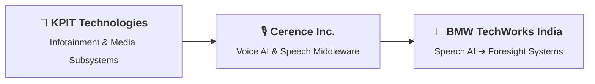

### Hi there, I'm Soham Dalwadi 👋

I am a **Senior Software Engineer** with **11+ years of dedicated experience** in the **automotive software industry**, specializing in **Voice Recognition (Speech AI)**, in-vehicle infotainment, and predictive vehicle technologies.

I believe great software engineering comes from technical curiosity, humility, and steady craft. While my foundation is centered on systems engineering and automotive middleware with **C and Modern C++**, I actively expand my horizons—building desktop tooling with **Qt**, developing native **Android & Kotlin** applications, and learning how next-generation **Foresight** systems make vehicle intelligence more predictive and context-aware.

---

### 🛣️ Career Journey

* **BMW TechWorks India** (*Nov 2024 – Present*): Engineering advanced automotive speech solutions and exploring next-generation **Foresight** technologies. Working in speech here also sparked my curiosity for modern **Android & Kotlin**, prompting me to build open-source mobile apps and side projects.
* **Cerence Inc.** (*Jun 2021 – Nov 2024*): Engineered automotive Voice AI integration, dialog frameworks, and robust automotive middleware.
* **KPIT Technologies** (*Feb 2015 – Jun 2021*): Developed foundational expertise in automotive infotainment, radio/media stacks, and embedded system integration.

---

### 🛠️ Core Focus & Stack

* **Languages**: `C`, `Modern C++`, `Kotlin`, `Python`, `Shell Scripting`
* **UI & Applications**: `Qt / QML`, `Android SDK`, `Jetpack Compose`
* **Automotive & Systems**: Voice Recognition (Speech AI), Foresight Systems, Connected Car (CarPlay, Android Auto)
* **Toolchain**: CMake, Docker, Linux / Yocto, Git, CI/CD
